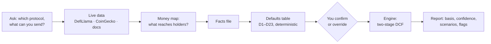

# protocol-valuation

**Value a crypto token from the cash that actually reaches its holders, and derive the multiple instead of borrowing it.**

[](https://github.com/hoeeem/protocol-valuation/actions/workflows/tests.yml)


[](LICENSE)

An agent skill for Claude, Grok and any agent that reads `SKILL.md`. Ask it to value a token. It then:
- gathers live data (DefiLlama, CoinGecko and the protocol's own docs);
- applies a fixed set of rules, so the same facts always give the same answer;
- shows you every judgement input before anything is valued;
- returns bear, base and bull fair values, the growth the price already assumes, and an honest rating of how reliable the inputs are.

Most token "valuations" borrow a P/E from peers. Peers are often mispriced, so the number inherits their mistakes. This skill builds the multiple from the protocol's own return on equity, growth and cost of equity instead.

> Model output under stated assumptions, not financial advice.

---

## What you get

Live run, 15 October 2026 (same data, protocol-valuation 6.6.0):

| Token | Fair value vs price | Input confidence | Why |
|---|---|---|---|
| HYPE | +6% | MEDIUM | growth comes from fixed perps constants, not live market data |
| PUMP | −9% | MEDIUM | no market series; moat score on a band edge; buybacks assumed to continue after their commitment |
| STONK | +616% | LOW | 72 days of history, earnings decaying, result far from the price |
| PONS | −2% | LOW | 93 days of history, no market series |

The STONK figure is not a buy signal. It's the case the skill is built to catch. The report flags it EXTREME and DECAYING, rates the inputs LOW, and shows the market is pricing revenue falling by 45% a year.

Every report includes:
- **Valuation basis:** either existing holder earnings (buybacks or distributions running today) or conditional ones (the value if a named mechanism switches on).
- **Input confidence:** LOW, MEDIUM or HIGH, with the reasons. Precise numbers from weak inputs say so.
- **Bear / base / bull values**, probability-weighted 20/60/20, with three cross-checks: a DCF, P/E × EPS and an earnings-yield path.
- **Break-even growth:** the growth rate today's price already assumes.
- **The judgement table:** every default with its rule, its class (method, calibrated, heuristic or judgement) and its source, for you to confirm or override.
- **Flags, verbatim:** for example DECAYING, REVENUE CHECK, BORDERLINE MOAT, COMMITMENT ASSUMED TO CONTINUE and EXTREME RESULT.

## How it works



1. **Holder earnings (E0).** The skill counts only the revenue that reaches token holders through buybacks or distributions, not fees or "revenue" in general. With a year of history it uses the trailing twelve months. With less, it takes the lower of two short run-rates and caps them at what current protocol revenue can fund.
2. **Cost of equity, layer by layer.** The risk-free rate and equity risk premium, plus premiums for regulation, governance, alignment of fee routing, smart-contract risk and a short track record.
3. **Supply.** Every token with a claim on the cash counts: vested and unclaimed tokens, scheduled vesting and future emissions, less what buybacks retire.
4. **Derived multiple.** After seven explicit years, the steady-state P/E is `(1 − g/ROE) / (Ke − g)`. ROE comes from a moat assessment (Helmer's 7 Powers and Porter's 5 Forces).
5. **Scenarios and the market's view.** Bear, base and bull, plus the growth rate at which the value equals today's price.

Protocols whose revenue doesn't reach holders yet (a fee switch that's off, or paused buybacks) are valued conditionally. The report gives the value if the mechanism switched on today, and the activation probability the price implies.

The full method is in [`skills/protocol-valuation/reference/METHOD.md`](skills/protocol-valuation/reference/METHOD.md). Every constant, its rationale and its limits are in [`CALIBRATION.md`](skills/protocol-valuation/reference/CALIBRATION.md).

## Install

Download `protocol-valuation.zip` from the [latest release](https://github.com/hoeeem/protocol-valuation/releases/latest), or use the folder [`skills/protocol-valuation`](skills/protocol-valuation).

| Where | How |
|---|---|
| **Claude** (claude.ai, desktop, mobile) | Customize → Skills → **+** → Create skill → Upload a skill → choose the zip, then switch it on. Code execution must be enabled. |
| **Claude Code** | `/plugin marketplace add hoeeem/protocol-valuation`, then `/plugin install protocol-valuation@protocol-valuation`. Or copy the folder to `~/.claude/skills/protocol-valuation`. |
| **Grok Build** (CLI) | Copy the folder to `~/.grok/skills/protocol-valuation`. |
| **Grok Bot** | Ask your Bot to install it from this repository: step-by-step guide in [`docs/grok-bot.md`](docs/grok-bot.md). |
| **Any other agent** | Give it the folder: it needs to read `SKILL.md` and run Python 3.8+. |

More detail is in [`docs/install.md`](docs/install.md).

## Try the engine directly

No install and no dependencies: standard-library Python 3.8 or later.

```bash
cd skills/protocol-valuation
python3 scripts/selftest.py                      # calibration case: ALL CHECKS PASSED
python3 scripts/engine.py defaults examples/calibration_facts.json --md judgement.md --json inputs.json
python3 scripts/engine.py inputs.json --md valuation.md
```

That reproduces the calibration case: Hyperliquid in mid-July 2026, probability-weighted DCF $119.86 at a $70 price, break-even growth 31.3%.

## Repository layout

```
skills/protocol-valuation/   the skill (this folder is what the release zip contains; changelog inside)
  SKILL.md                   the workflow the agent follows
  reference/                 method, facts schema, docs-research guide, calibration register
  scripts/                   engine, defaults step, data tools, self-test, edge-case tests
  examples/                  calibration case and a conditional (fee-switch) example
tests/                       stress tests: independent maths, fuzzing, hostile inputs, docs consistency, workflow
docs/                        install guides and the test report
```

## Testing

```bash
bash tests/run_all.sh            # everything, a few minutes
```

Each release passes all of these on Python 3.8 and 3.13:

| Suite | Result (6.6.0) |
|---|---|
| Self-test on the calibration case | pass |
| Edge-case and regression tests | 77/77 |
| Maths re-derived in separate code | 72/72 |
| Hostile and malformed inputs | 84/84 |
| Docs match the code | 74/74 |
| Workflow run end to end | pass |
| Property-based fuzzing | 15,000 cases, 0 failures |

GitHub Actions runs the suite on every push and pull request. The full history is in [`docs/TEST-REPORT.md`](docs/TEST-REPORT.md).

## Limitations

The skill is explicit about what it can't do. Every limitation is listed in [`CALIBRATION.md`](skills/protocol-valuation/reference/CALIBRATION.md#known-limitations). The main ones:
- **It values cash flows only.** Governance rights, collateral premiums and memes are not modelled. A protocol with no holder earnings and no named mechanism to start them is reported as not valuable with this method.
- **Young tokens are volatile.** Under a year of history, the inputs rest on short run-rates, and the confidence rating is LOW.
- **The defaults are calibrated on one case.** Many constants come from one well-documented calibration case and are labelled as such. Overrides are expected and recorded.

## Credits

The method (derived rather than borrowed multiples, the layered cost of equity, the three growth levers and the moat-to-ROE bands) is adapted from Jean-Yves Devloo, ["Hyperliquid: Stop Borrowing Multiples, Start Deriving Them"](https://www.blocmates.com/articles/hyperliquid-stop-borrowing-multiples-start-deriving-them), Blocmates, 16 July 2026. The generalised rules, data pipeline, scripts and tests are this project's own, and so are any errors. [`CALIBRATION.md`](skills/protocol-valuation/reference/CALIBRATION.md) lists which parts come from the article and which this project adds. This project isn't affiliated with Blocmates, Hyperliquid, DefiLlama, CoinGecko, Anthropic or xAI.

## Licence

[MIT](LICENSE). Model output under stated assumptions, not financial advice. Nothing here is a recommendation to buy or sell anything.
